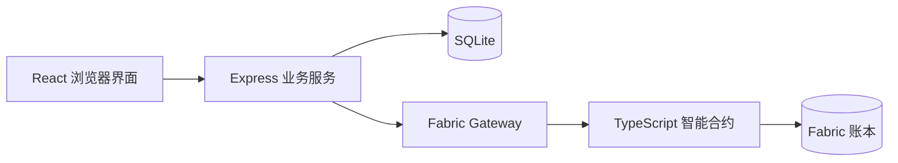

# FairPass

基于 Hyperledger Fabric 的校园活动票务系统，将活动报名、限额抽签、电子门票、票权转让和现场验票整合在同一应用中。系统采用 React + TypeScript 前端、Express + SQLite 后端，以及 TypeScript 智能合约。

## 应用场景

校园音乐会、讲座和工作坊常常面临名额有限、临时无法到场、门票归属需要核对等情况。FairPass以一张电子门票连接名额分配、持有人变更和入场核验，关键操作记录可按活动或门票查询。

## 功能展示

| 身份 | 功能 |
| --- | --- |
| 学生 | 浏览活动、报名、查看中签结果、领取门票、按用户名转让、查看票号与操作历史 |
| 主办方 | 创建活动、发布抽签、查看报名与票务统计、筛选和查询链上记录 |
| 验票员 | 输入票号或扫码查询、复核活动及持有人、确认核销、识别已使用门票 |

门票提供堆叠和平铺视图，正面展示活动信息，背面展示二维码、票号和操作记录。转让确认后即时更新持有人；每票在开场前最多转让一次。验票从开场前30分钟开放至活动结束，每票核销一次。页面时间统一使用UTC+8。

## 演示主线

**morgan创建一个名额的活动 → alex和jamie报名 → 中签者领票 → 转给未中签者 → taylor验票 → morgan查看记录。**

抽签产生的实际中签者负责领票，另一名学生接收转让。整个流程使用同一活动、同一票号，最终展示报名2人、中签1人、领票1张、核销1张及五类关键操作记录。

## 技术架构



SQLite保存账号、活动介绍、报名与抽签编排数据；Fabric保存中签资格、门票归属、发行及核销计数和操作历史。后端执行身份与资源权限校验，智能合约约束票务状态转换。交易经提交确认后返回结果，历史区块号通过QSCC查询。

## 快速启动

需要Node.js 22、npm 10+。在PowerShell中打开两个终端。

后端：

```powershell
cd backend
npm ci
npm run demo:mock
```

等待 `READY: clean Mock demo`，约两分钟自动准备账号和7个活动，包括展示门票、开放报名、待领票和待验票场次。Mock使用本地模拟账本；每次启动生成全新演示数据。

前端：

```powershell
cd frontend
npm ci
Copy-Item .env.example .env.local
npm run dev -- --strictPort
```

访问 `http://127.0.0.1:5173/`。API地址由 `frontend/.env.local` 中的 `VITE_API_BASE_URL` 设置，默认 `http://127.0.0.1:3000/api/v1`。PowerShell中也可使用 `npm.cmd` 执行命令。

## 演示账号

登录时选择对应身份，再填写账号和密码。密码统一为 `123456`。

| 账号 | 身份 | 用途 |
| --- | --- | --- |
| alex | 学生 | 报名、领票、转让 |
| jamie | 学生 | 报名、领票、接收或发起转让 |
| morgan | 主办方 | 创建活动、抽签、查看统计与记录 |
| taylor | 验票员 | 查询门票和核销 |
| casey | 学生 | 多人报名场景 |

账号定义在 `backend/src/db/seed.ts`，用户名大小写不敏感地唯一。转让时填写接收方用户名。

## Fabric运行与数据准备

完整安装、证书配置、启动及链码升级步骤见 [Fabric环境指南](docs/LOCAL_FABRIC_SETUP.md)。真实模式设置 `FABRIC_GATEWAY_MODE=real`，由服务身份连接Fabric网络。

后端运行后，在实际运行后端的目录执行：

```sh
npm run demo:campus
npm run demo:interactive
```

`demo:campus` 准备校园活动和展示门票；`demo:interactive` 准备开放报名、待领票及待验票场次。再次运行补充已使用或过期的场次，加 `-- --new` 可创建新场次。`demo:prepare` 准备专门用于领取和转让的 Pass it on. 活动。

自行创建活动时，按实际时间设置“当前时间＜报名截止＜开始＜结束”。截止后、开场前发布抽签；领票和转让在开场前完成。

## 源码结构

```text
frontend/       界面、登录、票卡动画及API客户端
backend/        认证、业务服务、数据库、Gateway与演示数据脚本
blockchain/     智能合约与部署升级脚本
docs/           技术报告、接口契约、环境及录制指南
design/         界面设计参考
```

源码附依赖锁文件、配置模板和数据初始化脚本。运行时生成的数据库、账本、证书、私钥和本地配置保存在运行环境中。前端执行 `npm run build`，后端及链码分别执行 `npm run build` 构建。

## 文档

- [项目技术报告](docs/PROJECT_TECHNICAL_REPORT.md)
- [业务与链码契约](docs/SHARED_CONTRACT.md)
- [HTTP接口规范](docs/API_V1.md)
- [Fabric环境指南](docs/LOCAL_FABRIC_SETUP.md)
- [视频录制指南](docs/VIDEO_RECORDING_CHECKLIST.md)
