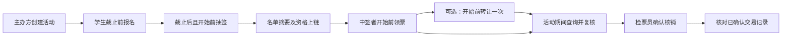
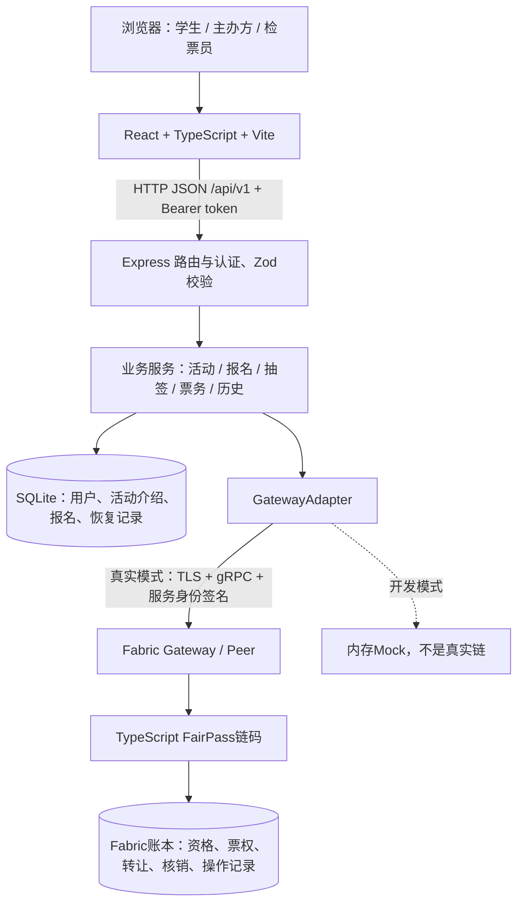

# FairPass 项目介绍与技术报告

> 用途：课程项目介绍文档、答辩PPT内容依据、展示讲解准备材料。代码核对日期：2026-10-20；基线提交：`9fa3070`。本文描述当前仓库实现，不把后期设想写成既有成果。本轮依据源代码与测试脚本核对，未重新启动真实网络、执行真实端到端验收或采集现场截图；最终运行证据需按配套清单补齐。

## 1. 项目介绍

FairPass 是面向校园限额活动的区块链票务 B/S 应用，覆盖主办方创建活动、学生报名、抽签发布、中签领票、门票转让、检票核销和操作记录查询。学生、主办方与检票员通过浏览器访问系统；后端处理身份、业务编排与普通数据存储，通过 Hyperledger Fabric Gateway 调用 TypeScript 智能合约，把关键票务状态及其变更记录写入联盟链。

一句话介绍：**让校园活动从名额分配到入场核验形成可追溯的票务闭环。**

### 1.1 实际问题与应用场景

适用场景包括校园演出、讲座、工作坊、电影放映等“参与人数可能超过场地容量、需要分配名额并现场验票”的活动。传统表单、群消息和截图凭证分散在多个工具中，容易出现名单版本不一致、票转出后双方都认为自己持票、重复出示同一凭证，以及事后无法统一核对的情况。

| 实际问题 | 产品处理方式 | 当前实现的作用与边界 |
|---|---|---|
| 名额有限，抢先报名受网络和时间影响 | 截止后在报名人中随机抽取中签者 | 后端使用密码学安全随机源；链上固定发布结果，不等于已证明平台抽签过程完全可信 |
| 中签名单发布后可能产生争议 | 上链名单摘要和中签资格 | 可核对已发布名单的一致性，链码不允许再次发布；不能证明原始报名集合未被平台操纵 |
| 截图凭证无法反映最新票权 | 用链上 ownerId 表示当前持有人 | 转让后原持有人失去票权，接收人无需再次确认 |
| 同一票被重复使用 | 核销状态由链码限制为一次 | 重新查票会显示已核销，不能再次放行 |
| 多个环节难以追责与核对 | 保存创建、抽签、领取、转让、核销记录 | 可查看交易 ID、操作类型、时间和相关主体；普通报名不属于链上交易 |

以上是项目针对的问题和设计目标，不能据此声称已经完成真实校园部署或取得用户调查结果。

### 1.2 产品方案与范围

系统采用“链下处理常规业务、链上保存关键凭证”的方案。SQLite 管理用户、活动描述、报名及抽签恢复数据；Fabric 保存活动容量与时间、抽签资格、门票归属、转让次数、核销状态及业务操作记录。

当前课程版本不包含付费购票、退款、二级市场定价、实名校园认证、转让邀请接受/拒绝、生产级动态票码和完整运维后台。它使用预置演示账号，展示核心票务闭环及区块链应用方式。

## 2. 设计思路与角色功能

### 2.1 角色权限

| 角色 | 主要功能 | 权限限制 |
|---|---|---|
| 学生 STUDENT | 活动浏览、报名、查询报名结果、领票、当前门票、转让、票务历史 | 只能操作本人身份；领票需中签，转让需当前持票 |
| 主办方 ORGANIZER | 创建活动、查看本人活动统计、抽签、查看链上记录 | 只能管理本人创建的活动 |
| 检票员 INSPECTOR | 票号/扫码查询、复核、核销 | 当前课程版本可以核验全部活动，尚未按活动分配检票权限 |

真实API模式先在右上角选择学生、主办方或验票员，再输入账号和密码。后端同时校验三者，成功后签发token；登录后账户菜单显示用户名和身份，只提供退出登录，不提供免密切换账号。

### 2.2 核心业务流程



关键设计是区分“报名”“中签”“持票”三个概念。报名仅取得参与抽签的机会；中签取得领票资格；领取成功才产生门票。转让改变当前持有人，原始中签者字段保留，便于追溯来源。

### 2.3 业务状态与时间约束

活动主要状态为 `OPEN → DRAWING → DRAWN`；达到结束时间后，后端读取时呈现 `FINISHED`。`OPEN` 仍需结合截止时间判断能否报名，不能仅看状态文字。`DRAWING` 表示结果正在发布或等待对账，相关操作保持受限。

| 操作 | 必须满足的条件 |
|---|---|
| 创建 | 容量为正整数，报名截止 < 开始 < 结束 |
| 报名 | 学生，活动开放，当前时间 < 截止，每人每活动一次；当前报名上限1000 |
| 抽签 | 本活动主办方，截止 ≤ 当前时间 < 开始，仅发布一次 |
| 领票 | 已确认中签，当前时间 < 开始，未领取且未超发 |
| 转让 | 当前持有人，接收人为其他已存在学生，当前时间 < 开始，票有效且未转让过 |
| 核销 | 检票员，开始前30分钟 ≤ 当前时间 < 结束，票未核销 |

门票状态只有 `ACTIVE` 和 `REDEEMED`。是否转让以 `transferCount` 表示，不单独设“已转让”票状态；每张票最多转让一次。接收人可以没有报名或中签。当前没有“待接收确认”流程，界面不再提供待接收入口。

## 3. 技术开发方案与架构

### 3.1 总体架构



### 3.2 技术选型

| 层次 | 当前技术 | 选择原因 |
|---|---|---|
| 前端 | React 19、TypeScript、Vite 6、CSS、qrcode.react | 组件化实现三角色页面、票卡交互和二维码，类型约束接口数据 |
| 后端 | Node.js 22、Express 5、TypeScript | 统一语言，便于连接 Fabric SDK，分离路由、服务、仓储 |
| 参数与身份 | Zod、jose，HS256 JWT | 集中校验请求；演示身份使用签名token、有效期和角色检查 |
| 普通数据库 | better-sqlite3 / SQLite | 课程本地部署轻量，支持事务、外键、唯一约束和WAL |
| 链接入 | @hyperledger/fabric-gateway、@grpc/grpc-js | 通过证书与TLS连接，进行背书、提交及commit确认 |
| 智能合约 | TypeScript、fabric-contract-api、fabric-shim | 在Fabric交易中执行票务约束并更新状态与索引 |
| 本机网络 | Windows + Ubuntu-22.04 WSL2 + Docker + Fabric test-network | 支撑本机真实联盟链开发和演示；不是生产多机构部署 |
| 测试 | Vitest、Supertest、Node test、真实HTTP验收脚本 | 覆盖API行为、恢复路径、链码规则及真实联调 |

依赖精确版本以各目录的 lockfile 为准。本机环境文档记录 Fabric 2.5.16、通道 `mychannel`、链码 `fairpass`。不要将软件包版本、Fabric二进制版本和fabric-samples标签混为同一版本。

### 3.3 数据划分与模型

| 存储 | 数据 | 说明 |
|---|---|---|
| SQLite users | ID、演示账号、显示名、角色 | 未实现真实身份验证，账号名唯一 |
| SQLite events | 标题、描述、地点、容量、各时间、主办方、本地状态、抽签摘要和交易ID | 通过活动ID与链上记录关联 |
| SQLite registrations | 报名人、活动、REGISTERED/WON/LOST | `(event_id,user_id)`唯一，阻止重复报名 |
| SQLite draw_winners / draw_attempts | 已确认中签者、固定候选名单、摘要、PENDING/CONFIRMED/CONFLICT | 支持发布结果未知时恢复，避免重新抽一份名单 |
| SQLite idempotency_keys | 创建意图key、请求摘要、actor、eventId和确认状态 | 防止创建重试生成多个活动 |
| Fabric ChainEvent | 容量、开始结束时间、主办方ID、是否发布、名单哈希、各票务计数 | 关键票务条件及计数依据 |
| Fabric Eligibility | 活动、学生ID、是否已领取 | 中签者可领一次 |
| Fabric Ticket | 票ID、活动、originalWinnerId、ownerId、状态、转让次数、领取/核销时间 | 当前票权以链上为准 |
| Fabric Operation / 索引 | txId、类型、时间、操作者、转出/接收人；owner与event/ticket索引 | 支持当前票和活动/门票历史查询 |

“报名个人信息不上链”指普通报名资料不直接写链。链上资格、票和操作记录仍含用户UUID，因此不能宣称完全匿名或链上没有任何用户标识。

## 4. 关键实现原理

### 4.1 抽签及结果固化

后端在 SQLite 即时事务中锁定处理状态，采用 Fisher–Yates 洗牌，以 `node:crypto.randomInt` 提供随机索引，再选取 `min(容量, 报名人数)` 人。中签ID去重排序后转成规范JSON，并计算 SHA-256。候选名单与哈希先持久化，同时把活动设为 `DRAWING`。

后端调用 `PublishDraw(eventId,winnerIdsJson,winnersHash)`；链码核对容量、列表及摘要，拒绝重复发布，在同一交易中保存中签资格和活动结果。确认后后端更新报名为 `WON/LOST`，活动进入 `DRAWN`。

该方案使已发布结果可核对且不能通过正常接口重复抽签。随机源、原始报名集合和名单生成仍由平台控制；哈希是名单一致性证据，不是随机公平性的密码学证明。当前没有 VRF、承诺揭示或参与方联合随机协议。

### 4.2 领票、票权和防超发

票ID确定性生成：

```text
ticketId = SHA256("ticket:" + eventId + ":" + originalWinnerId)
```

同一活动同一中签者对应同一票ID。链码检查已发布资格、未领取、活动未开始和发行数未超过容量，在同一交易中写票、标记资格已领、增加发行数并建立owner索引。重复请求会被拒绝，不会多发一张票；网络结果未知时后端可以按同一票ID对账。

### 4.3 转让与一次核销

转让更新 `ownerId` 和 `transferCount`，移除原持有人索引、建立接收人索引，并写操作记录。票号及 `originalWinnerId` 保持不变。链码检查传入的转出人是否为当前owner，后端负责把操作人绑定到token身份、检查接收人是否为学生。

核销由检票员先查票、人工复核、再提交。链码使用 Fabric 交易时间戳判断窗口，把状态从 `ACTIVE` 改为 `REDEEMED`，更新活动核销数及操作记录。重复核销被拒绝；页面成功结果包含本次确认交易ID。二维码当前只编码静态 `ticketId`，不具备动态防截图或完整持有人现场认证能力。

### 4.4 交易确认、失败与恢复

真实适配器通过 `newProposal → endorse → submit → getStatus` 完成交易，要求commit结果成功；随后按本次精确txId查询对应操作记录。发出请求不等于交易成功。

SQLite和Fabric没有跨系统原子事务，项目采用持久化处理意图与读链对账来恢复。创建活动固定eventId和幂等key；抽签固定名单及哈希；领票固定ticketId。提交超时后先查询链上，已生效则校验并收尾，确认未生效才有限重试；状态冲突或无法确认时返回503。核销恢复还必须核对本次txId对应记录，不能拿“最新一条历史”猜测本次成功。

这属于针对业务的恢复机制，不能描述成已经实现链下数据库与区块链的分布式原子事务。

### 4.5 身份与信任边界

本地课程账号通过账号、密码与所选身份登录，后端验证通过后签发JWT。共享本地演示密码默认123456，可由DEMO_LOGIN_PASSWORD配置；服务端使用scrypt派生值与恒定时间比较进行校验。当前不是生产用户注册或完整凭据管理系统。后端校验签名、issuer、audience、有效期以及用户和角色一致性，并进一步检查资源归属。生产认证不在当前范围。

Fabric交易由平台服务证书签名，不是每位学生各自用证书签名。链码主要验证票务规则，用户角色、接收人存在性和操作人与token的绑定由后端负责。当前仍需信任平台后端和服务身份管理；本机test-network展示的是联盟链机制，不能据此宣称三位组员或三类用户就是三个独立链组织。

### 4.6 操作历史与错误处理

五种关键操作为 `EVENT_CREATED`、`DRAW_PUBLISHED`、`TICKET_CLAIMED`、`TICKET_TRANSFERRED`、`TICKET_REDEEMED`。链码通过复合键存储按活动和按门票索引的业务记录；这是应用自己维护的账本记录查询，不是独立区块浏览器。

后端补充通道和链码名称。当前普通历史查询的 `blockNumber` 为null，页面显示“未提供”；提交确认结果可包含实际区块号，不能补造历史区块号。交易ID可用于定位和核对，但仅有64位字符串的外观不能单独证明真实上链，需要结合real配置、真实网络及查询结果。

统一API错误包含稳定code、中文message和requestId。参数错误400、未登录401、权限不足403、资源不存在404、业务冲突409、时间状态不允许422、Fabric不可用503。超时必须查询实际状态后再决定是否重试。

## 5. 接口与代码导航

完整字段和权限见 [API_V1.md](API_V1.md)，共同规则见 [SHARED_CONTRACT.md](SHARED_CONTRACT.md)。

| 业务 | 主要接口 | 关键实现 |
|---|---|---|
| 登录 | POST /auth/demo-login，GET /auth/me | backend/src/services/auth-service.ts、demo-token-service.ts |
| 创建与活动 | POST /events，GET /events、/me/events、/events/:id | event-creation-service.ts、event-service.ts |
| 报名 | POST /events/:id/registrations，GET /me/registrations | registration-service.ts、registration-repository.ts |
| 抽签 | POST/GET /events/:id/draw | draw-service.ts、draw-repository.ts |
| 领票 | POST /events/:id/tickets/claim | ticket-service.ts |
| 查票与转让 | GET /me/tickets、/tickets/:id，POST /tickets/:id/transfer | ticket-service.ts |
| 核销 | POST /tickets/:id/redeem | ticket-service.ts、routes/tickets.ts |
| 历史 | GET /events/:id/operations、/tickets/:id/operations | operation-service.ts |

表内接口统一加 `/api/v1` 前缀。核心链码位于 `blockchain/chaincode/src/fairpass.ts`；真实适配器在 `backend/src/fabric/real-gateway-adapter.ts`。前端角色组织与门票交互在 `frontend/src/App.tsx`，学生页面在 `pages/StudentPages.tsx`，主办方与检票在 `pages/RolePages.tsx`，票堆与翻面在 `components/TicketStage.tsx`。

## 6. 最终成果与效果展示

### 6.1 仓库已实现成果

1. 三角色浏览器界面，包括活动列表、报名进度、票堆/平铺、翻面二维码、活动管理和验票流程。
2. 完整v1业务API、SQLite迁移、五个预置演示账号和请求校验。
3. 活动、抽签资格、领取、转让、核销、owner索引和业务历史链码。
4. Mock与真实Fabric适配器、确认与对账机制。
5. 校园演示数据脚本、现场领票准备脚本和真实HTTP端到端验收脚本。

这是“代码实现成果”列表。正式提交时应另附本次运行结果、截图和录屏，不把仓库内已有脚本直接等同于本次现场验收通过。未开展负载测试或真实用户评估，不写TPS、响应时间、满意度或“高并发稳定”等未经测量的结论。

### 6.2 建议效果图与证据

| 图号 | 应采集画面 | 图注应说明什么 |
|---|---|---|
| 图1 | 学生活动首页 | 校园应用场景与活动入口 |
| 图2 | 报名成功与中签结果 | 报名不等于持票；中签可领取 |
| 图3 | 票堆/平铺及门票背面 | 票号、二维码、当前持有人与交互设计 |
| 图4 | 转让前后两账号同一票号 | 原持有人失权、接收人成为owner |
| 图5 | 主办方活动详情 | 容量、报名、中签、发行、核销计数 |
| 图6 | 核销成功与再次查询 | 一次核销及重复使用被阻止 |
| 图7 | 活动链上记录与详情抽屉 | 五类操作、txId、通道、链码和时间 |

截图应使用真实API+real模式。尚未采集的图保留为“待补截图”，不要以设计稿或预览数据冒充运行证据。图4、6、7优先使用同一演示活动及同一票号串联。

### 6.3 验证方法

前端在 `frontend/` 执行 `npm run build`；后端在兼容依赖环境执行 `npm run typecheck`、`npm test`；链码在 `blockchain/chaincode/` 执行 `npm test`。后端测试涵盖认证、参数、报名防重、创建幂等、抽签恢复、票务及历史；链码测试涵盖主要合约规则。

真实环境在WSL `/opt/fairpass-dev/backend` 执行 `npm run fabric:check` 和 `npm run test:e2e:real`。后者创建容量2活动、三人报名、两人中签、未中签者被拒领、两票领取、其中一票转让、到时间后核销两票，并验证重复领取/转让/核销、时间约束、真实历史及计数。脚本预期该活动共有7条关键操作。它会写入真实演示数据，不是纯只读检查。

正式报告补录：运行日期____；提交版本____；执行人____；命令与结果____；日志/截图文件____。没有实际执行的项目标“未执行”。

## 7. 团队组成与分工

团队共三人。当前对话只确认一位成员负责“详细技术文档与视频录制操作清单”，其他姓名、实际开发贡献和最终展示职责尚待团队填写。以下表格是确认入口，不代表已核实的开发分工。

| 成员 | 已确认/待确认的交付职责 | 实际开发贡献（本人核对后填写） | 交付物 |
|---|---|---|---|
| 成员A：姓名待填（本文提出者） | 详细技术文档、视频录制操作清单 | 待填：模块、接口、联调、修复等 | 本报告、VIDEO_RECORDING_CHECKLIST.md |
| 成员B：姓名待填 | 建议负责PPT制作与主讲，待团队确认 | 待填 | PPT、讲稿与排练记录 |
| 成员C：姓名待填 | 建议负责录屏执行、剪辑与展示操作，待团队确认 | 待填 | 展示视频、运行证据与素材 |

每位成员向文档负责人提供本人负责模块的实际说明和证据。技术问答按熟悉模块分配，不以“谁主讲”代替实际贡献。课程还要求组长按10分制评定成员贡献，应在事实确认后填写，本文不代填评分。

## 8. 后期改进思路

| 优先级 | 当前局限 | 后续方案与价值 |
|---|---|---|
| 高 | 预置账号与平台统一证书 | 对接校园SSO，完善用户认证、服务身份和证书权限治理 |
| 高 | 静态票号可能被截图转发 | 引入短时动态票码、挑战校验与现场身份核对，降低凭证复制风险 |
| 高 | 随机过程仍由平台控制 | 探索承诺揭示、联合随机或可验证随机机制，审计报名快照及分配规则 |
| 高 | 课程测试网络与恢复工具有限 | 多机构部署、监控、备份、恢复演练和异常交易运维界面 |
| 中 | 检票员可操作全部活动 | 增加活动级授权、检票班次、设备与操作审计 |
| 中 | 链上名单写入与当前分页不适合大规模 | 在实际压测后设计批量资格、索引与查询优化，完善并发冲突重试 |
| 中 | 未领取名额无法回流 | 设计明确截止、候补和回收规则，并同步修改合约与状态机 |
| 低 | 转让直接生效、无邀请确认 | 根据用户需要增加邀请、撤回、接受流程及对应合约规则 |

这些均为规划，PPT应放在“局限与展望”，不列入当前功能展示。

## 9. PPT制作与7分钟展示编排

建议8页，页面只提炼重点，讲解和细节以本报告为依据。课程7分钟展示、3分钟提问；下面的演示视频占用展示时间，不能在7分钟PPT之外再追加完整视频。若教师另有播放安排，按现场通知调整。

| 页 | 标题 | 页面内容与素材 | 建议用时 |
|---|---|---|---|
| 1 | FairPass：校园活动票务闭环 | 项目名、组员、首页效果图、一句话定位 | 20秒 |
| 2 | 为什么做：名额、票权与入场核验 | 第1章三个主要问题与校园场景 | 40秒 |
| 3 | 产品方案与设计思路 | 三角色、报名→中签→持票→核销流程，第2章 | 40秒 |
| 4 | 技术架构与链上/链下分工 | 第3章架构图及数据边界 | 50秒 |
| 5 | 智能合约如何约束票务 | 一次发布、防超发、一次转让、一次核销；第4章 | 40秒 |
| 6 | 功能演示 | 使用配套清单剪成约2分40秒视频；同票号串联 | 160秒 |
| 7 | 实现成果与验证 | 第6章真实截图、实际测试结果、交易详情 | 40秒 |
| 8 | 总结、局限与改进 | 第7—8章团队分工、三项局限与下一步 | 30秒 |

合计420秒。完整独立介绍视频可长于PPT嵌入版，但视频长度不是作业文件已明确的限制，本报告建议独立版约4—5分钟。

### 答辩常见问题与建议回答

**为什么不用普通数据库？** 普通数据库完全可以实现票务功能。本项目用Fabric演示联盟链中关键票权与操作记录的共享核对和合约约束；当前本机测试网络尚未提供真实多机构治理效果。

**抽签是否在链上执行，是否绝对公平？** 抽签在后端，密码学安全随机源用于洗牌，结果和资格上链固定。当前主要保证结果发布后的可核对与业务防重复，不能证明平台生成结果时完全无操纵。

**如何防止一张票重复入场？** 后端验证检票员身份，链码在有效时间内将票从ACTIVE改为REDEEMED，后续核销被拒。静态二维码的防盗用能力仍需完善。

**转让后原二维码是否还能用？** 票号不变，但owner已变。系统应以实时链上归属和核销结果为准；当前没有自动把静态二维码与现场真人绑定，不能宣称截图已彻底失效。

**链断了还能验票吗？** 当前关键状态读取和写入依赖Fabric，无法确认时返回不可用，不凭本地页面直接放行；离线核验尚未实现。

**请求超时怎么办？** 不立即认定失败，先按固定活动/门票标识及交易信息查询链上状态，再收尾或有限重试。

**链上是不是没有个人数据？** 普通报名资料留链下，但链上含用户UUID及票务关联，仍需考虑标识关联与隐私治理。

## 10. 使用与提交前检查

- PPT制作人：先读1—4章和第9章；效果截图按6.2采集；不要把规划写成成果。
- 视频与展示同学：执行 [视频录制操作清单](VIDEO_RECORDING_CHECKLIST.md)，先确认模式、账号、时间与票状态。
- 环境复现：以 [本机Fabric环境与演示复现](LOCAL_FABRIC_SETUP.md) 和 [后端说明](../backend/README.md) 为准。
- 最终提交：填写团队姓名、真实贡献和组长评分，补齐运行结果与截图；同时整理源码、PPT、项目介绍文档、录屏和任务分工材料。作业原文要求每位成员提交最终文件。
